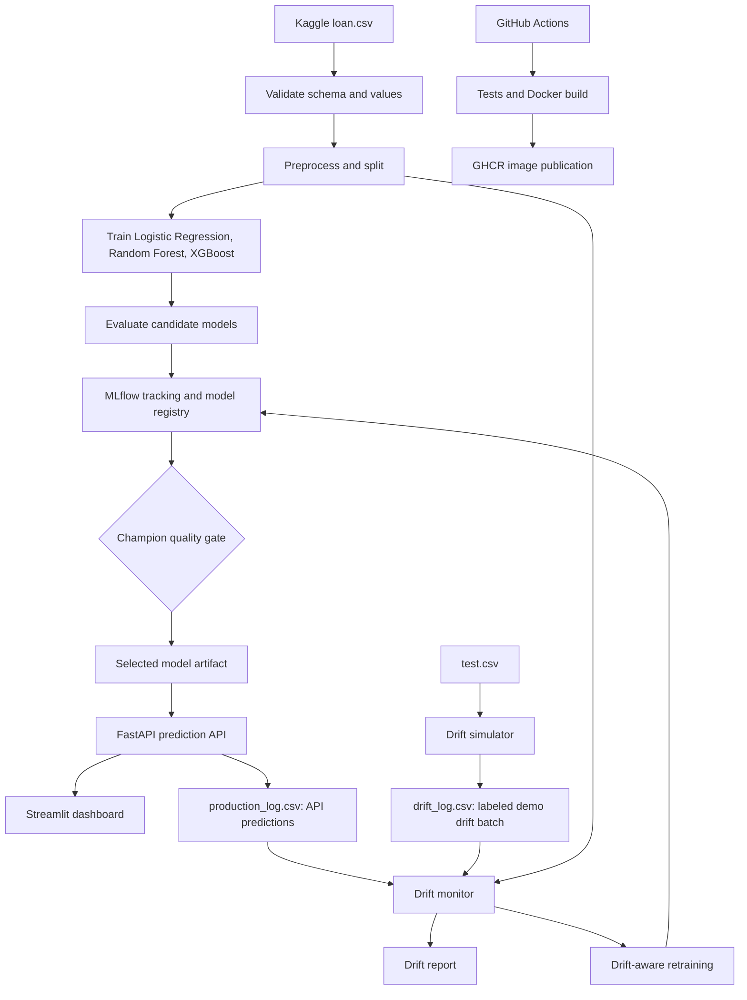
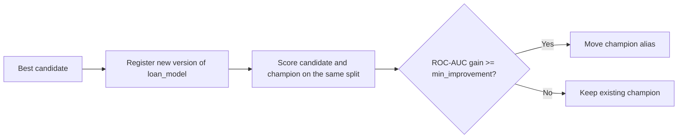

<div align="center">

# 🔍 LoanLens

### Loan approval prediction with a reproducible, monitored MLOps lifecycle

[CI](https://github.com/KAVINGUPTA09/loanops/actions/workflows/ci.yml) ·
[CD](https://github.com/KAVINGUPTA09/loanops/actions/workflows/cd.yml) ·
[Python](https://img.shields.io/badge/Python-3.11%20%7C%203.12-3776AB?logo=python&logoColor=white) ·
[FastAPI](https://img.shields.io/badge/API-FastAPI-009688?logo=fastapi&logoColor=white) ·
[Streamlit](https://img.shields.io/badge/UI-Streamlit-FF4B4B?logo=streamlit&logoColor=white) ·
[MLflow](https://img.shields.io/badge/Tracking-MLflow-0194E2?logo=mlflow&logoColor=white) ·
[DVC](https://img.shields.io/badge/Pipeline-DVC-945DD6?logo=dvc&logoColor=white) ·
[Docker](https://img.shields.io/badge/Container-Docker-2496ED?logo=docker&logoColor=white)

**A local-first academic project covering data validation, model comparison, serving, monitoring, drift-aware retraining, and CI/CD.**

[Quick start](#-quick-start) · [Features](#-features) ·
[Architecture](#-architecture) · [How it works](#-how-it-works) ·
[Repository guide](#-repository-guide) ·
[Full setup guide](#-full-setup-guide) ·
[Limitations](#-limitations-and-responsible-use)

</div>

> [!WARNING]
> LoanLens is an **academic demonstration, not a lending decision service**.
> Its model and data are not validated or approved for banking use. See
> [Limitations](#-limitations-and-responsible-use).

---

## 📖 Overview

LoanLens predicts a loan application's **approval probability** from
applicant, loan, and credit-history features. It wraps a machine-learning
pipeline in a REST API and a browser dashboard, and demonstrates how a model
can be **tracked, monitored, retrained, and packaged**.

Three classifiers compete on the same split within each training run:

| Model | Why it is included |
|---|---|
| **Logistic Regression** | Simple, interpretable baseline |
| **Random Forest** | Tree ensemble that can learn non-linear patterns |
| **XGBoost** | Gradient-boosted trees |

The best candidate is chosen by **ROC-AUC** (F1 breaks ties). The active model
is the MLflow `champion` alias, guarded by a quality gate. Decisions use a
configurable threshold in `params.yaml`:

```text
probability >= 0.65  ->  Approved
probability <  0.65  ->  Rejected
```

## ✨ Features

- ✅ **Data validation:** schema, row-count, range, and target checks before training
- 🧪 **Model comparison:** three estimators, metrics, and MLflow tracking
- 🏆 **Champion/challenger registry:** promotion only when a candidate clears the configured ROC-AUC improvement gate
- ⚡ **FastAPI serving:** Pydantic-validated inputs, probability, decision, and SHAP reasons
- 📊 **Streamlit dashboard:** prediction form, history, model comparison, drift, and retraining controls
- 🌊 **Drift monitoring:** KS test (numeric) and chi-square (categorical) with an HTML report
- 🔁 **Drift-aware retraining:** weighted merge of a labeled demo drift batch with the baseline
- ⚖️ **Explainability and fairness:** SHAP summaries and group metrics by Gender and Married
- 🔄 **Reproducible pipeline:** DVC stages from validation through fairness
- 🐳 **CI/CD:** tests, lint, Docker build, and GHCR publishing via GitHub Actions

## 🚀 Quick start

The detailed Windows setup, separate terminal commands, drift demo, and
troubleshooting are in [Full setup guide](#-full-setup-guide).

```powershell
git clone https://github.com/KAVINGUPTA09/loanops.git
cd loanops

py -3.11 -m venv .venv
Set-ExecutionPolicy -Scope Process -ExecutionPolicy RemoteSigned
.\.venv\Scripts\Activate.ps1
pip install -r requirements.txt

python scripts\setup_dvc.py
dvc repro
```

After the pipeline finishes, start the API and dashboard in separate
terminals:

```powershell
uvicorn app.main:app --reload
```

```powershell
streamlit run frontend\streamlit_app.py
```

Use the full setup guide at the end for MLflow, Swagger, prediction, drift,
and retraining steps. `data/loan.csv` must be available first; see
[Dataset and validation](#1-dataset-and-validation).

## 🏗️ Architecture



### Technology stack

| Technology | Role |
|---|---|
| Python, Pandas | Application code and tabular data processing |
| scikit-learn | Preprocessing, Logistic Regression, Random Forest, and metrics |
| XGBoost | Gradient-boosted candidate |
| DVC | Reproducible pipeline and data/output dependency tracking |
| MLflow | Runs, metrics, artifacts, model versions, `champion` alias |
| FastAPI, Pydantic | Validated REST API and model serving |
| Streamlit | Interactive prediction and monitoring dashboard |
| SHAP | Feature-contribution explanations |
| SciPy, Evidently | Statistical drift checks and HTML report |
| Pytest, Flake8 | Automated tests and style checks |
| Docker, GHCR | Container packaging and image registry |
| GitHub Actions | CI, image publishing, and drift workflow |

## 🧠 How it works

### 1. Dataset and validation

The dataset is the 614-row
[Kaggle Loan CSV](https://www.kaggle.com/datasets/tanishaj225/loancsv?resource=download),
stored at `data/loan.csv` (DVC pointer: `data/loan.csv.dvc`).

```text
Loan_ID, Gender, Married, Dependents, Education, Self_Employed,
ApplicantIncome, CoapplicantIncome, LoanAmount, Loan_Amount_Term,
Credit_History, Property_Area, Loan_Status
```

`Loan_Status` is the target (`Y` = approved, `N` = rejected). The validator
checks required fields, minimum row count, numeric ranges, and allowed target
values. Missing values are expected and handled inside the model pipeline.

> Check Kaggle's current license and terms before redistributing or using the
> data commercially.

### 2. Preprocessing

The target is converted to `1/0`, `Dependents=3+` becomes `3`, and a stratified
split produces **491 training / 123 test rows** with the configured seed.

The saved scikit-learn pipeline bundles preprocessing with the estimator:

- **Numeric:** median imputation → standard scaling
- **Categorical:** most-frequent imputation → one-hot encoding
- **Unseen categories:** ignored by the encoder instead of failing at serving time

One pipeline for both training and serving prevents training-serving skew.

### 3. Training and candidate selection

`src/train.py` fits all three models and logs parameters, metrics, a data hash,
and evaluation plots to MLflow.

| Metric | Meaning |
|---|---|
| Accuracy | Share of all predictions that are correct |
| Precision | Share of predicted approvals that are real approvals |
| Recall | Share of real approvals the model finds |
| F1 | Harmonic mean of precision and recall |
| ROC-AUC | Ranking quality across all thresholds |

Highest ROC-AUC wins; F1 breaks ties. Complexity does not decide the winner:
a linear model can beat tree models on a given dataset and split.

### 4. MLflow registry and champion gate

```text
mlflow.db  -> run and registry metadata (SQLite)
mlruns/    -> run artifacts
loan_model -> registered model
champion   -> alias for the active approved model
```



- Registering a version does **not** make it champion.
- Candidate and incumbent are compared on the **same evaluation split**.
  ROC-AUC tags from runs on different splits (for example baseline versus
  drift-augmented) are not directly comparable.
- The dashboard's **Promote latest candidate (demo)** button bypasses the gate.
  It is a demo shortcut, not the normal promotion path.

### 5. API and dashboard

| Endpoint | Purpose |
|---|---|
| `GET /health` | Readiness and selected model metadata |
| `GET /model-info` | Active model, metrics, registry version, and decision metadata |
| `POST /predict` | Validates input; returns prediction, probability, and SHAP reasons |

FastAPI loads the selected local model artifact at startup. The Streamlit
dashboard **calls the API**; it does not score applications itself.

### 6. Prediction history vs. drift data

| File | Contents | Written by |
|---|---|---|
| `data/production_log.csv` | Inputs and outputs of successful API predictions | API, one row per prediction |
| `data/drift_log.csv` | Intentionally shifted, **labeled** demo batch | Drift simulator, built from `data/test.csv` |

The simulator shifts features such as loan amount, term, credit history,
education, and property area, while retaining held-out Kaggle labels for the
retraining demo. It does not overwrite the API log.

The drift monitor compares `data/train.csv` (reference) with
`data/drift_log.csv`, falling back to `data/production_log.csv` if no drift
batch exists. Numeric columns use the **Kolmogorov-Smirnov** test, categorical
columns use **chi-square**, and `drift.threshold` sets the share of drifted
features needed to trigger. Output is `reports/drift_report.html` (Evidently,
with a SciPy-based fallback).

### 7. Drift-aware retraining

Retraining requires a drift batch with a `Loan_Status` target. It:

1. Merges a **weighted sample** of the labeled batch with the original training baseline.
2. Creates a new stratified train/evaluation split in separate temporary files; the DVC baseline split remains untouched.
3. Trains and evaluates all three candidates.
4. Refreshes evaluation, SHAP, and fairness outputs.
5. Registers a candidate in MLflow; the quality gate decides whether it becomes champion.

> [!IMPORTANT]
> **Production caveat:** live predictions have no verified outcome labels. A
> real retraining loop must wait for confirmed loan outcomes and must never
> treat a model's own predictions as ground truth. The labeled drift simulator
> is a controlled demo, not a real feedback system.

### 8. Fairness and explainability

SHAP estimates feature contributions and powers global reports plus
per-prediction reasons. Fairness reporting compares **approval rate and
recall** across Gender and Married groups. These are diagnostics: SHAP is not
causal, and group metrics are not a legal fairness certification.

### 9. DVC, Docker, and CI/CD

```text
validate -> preprocess -> train -> evaluate -> explain -> fairness
```

- `dvc repro` runs stale stages; `dvc repro -f` forces all stages.
- DVC does **not** start MLflow, FastAPI, or Streamlit.
- `dvc.lock` records pipeline state; `dvc push` sends objects to the configured remote.

| Workflow | What it does |
|---|---|
| CI | Installs dependencies, runs DVC, lint, tests, and a Docker build |
| CD | Builds and publishes the image to GHCR |
| Drift check | Runs manually or on schedule and uploads the report |

```text
ghcr.io/kavingupta09/loanops:latest
ghcr.io/kavingupta09/loanops:<commit-sha>
```

Publishing an image is not deploying it. AWS ECR/ECS is not configured, and
CD triggers a Render deployment only if a deploy-hook secret is set.

## 🗂️ Repository guide

```text
loanops/
├── app/                  FastAPI service
├── frontend/             Streamlit dashboard
├── src/                  Pipeline stages
├── scripts/              Helpers, drift simulator, smoke test
├── tests/                API, data, and model tests
├── data/                 Raw, split, production-log, and drift CSVs
├── models/               Selected pipeline and metadata
├── reports/              Evaluation, fairness, SHAP, drift outputs
├── docs/                 Report, presentation, self-audit, viva material
├── .github/workflows/    CI, CD, drift check
├── dvc.yaml / dvc.lock   Pipeline definition and state
├── params.yaml           Tunable settings
├── Dockerfile
├── docker-compose.yml
└── requirements.txt
```

<details>
<summary><b>File-by-file responsibilities</b></summary>

| Path | Responsibility |
|---|---|
| `app/main.py` | API, request validation, model loading, prediction, SHAP reasons, prediction logging |
| `frontend/streamlit_app.py` | Dashboard, API calls, history, model comparison, drift/retrain buttons |
| `src/validate_data.py` | Schema, target, row-count, and range checks |
| `src/preprocess.py` | Target conversion, normalization, train/test split |
| `src/train.py` | Pipelines, three estimators, metrics, MLflow registration, champion gate |
| `src/evaluate.py` | Confusion matrix, ROC curve, metrics output |
| `src/explain.py` | SHAP summary report |
| `src/fairness.py` | Approval-rate and recall summaries by group |
| `src/drift.py` | Statistical drift tests and HTML report |
| `src/retrain.py` | Labeled-batch preparation, retraining split, lifecycle rerun |
| `src/utils.py` | Parameter loading, paths, hashing, JSON helpers |
| `scripts/simulate_drift.py` | Creates the separate drift-demo batch |
| `scripts/promote_latest_candidate.py` | Demo-only manual promotion |
| `scripts/smoke_test.py` | End-to-end local smoke workflow |
| `scripts/setup_dvc.py` | One-time local DVC remote setup |

</details>

## ⚙️ Configuration

Key options in `params.yaml`:

| Setting | Meaning |
|---|---|
| `random_state` | Reproducibility seed |
| `paths.*` | Dataset, model, and report paths |
| `training.test_size` | Test split proportion |
| `training.min_improvement` | Minimum ROC-AUC gain required for promotion |
| `training.approval_threshold` | Decision threshold (currently `0.65`) |
| `training.drift_weight` | Fraction of the drift batch added during retraining |
| `training.models.*` | Estimator hyperparameters |
| `drift.threshold` | Drifted-feature share needed to trigger |
| `drift.min_rows` | Minimum current-batch size for monitoring |

## 🛠️ Full setup guide

Commands are shown for **Windows PowerShell**, with macOS/Linux equivalents
where they differ. Run everything from the repository root, and keep each
long-running service in its own terminal.

### Prerequisites

- Python 3.11 (recommended; CI uses it) or 3.12
- Git
- Docker Desktop (only for containers)

### Step 1: Get the code and environment

```powershell
git clone https://github.com/KAVINGUPTA09/loanops.git
cd loanops

py -3.11 -m venv .venv
Set-ExecutionPolicy -Scope Process -ExecutionPolicy RemoteSigned
.\.venv\Scripts\Activate.ps1
python -m pip install --upgrade pip
pip install -r requirements.txt
```

Use `py -3.12` instead if Python 3.11 is unavailable.

<details>
<summary>macOS / Linux</summary>

```bash
git clone https://github.com/KAVINGUPTA09/loanops.git
cd loanops
python3.11 -m venv .venv
source .venv/bin/activate
python -m pip install --upgrade pip
pip install -r requirements.txt
```

</details>

### Step 2: Add and validate the data

Download `loan.csv` from
[Kaggle](https://www.kaggle.com/datasets/tanishaj225/loancsv?resource=download)
into `data/` if it is not already present, then:

```powershell
python -m src.validate_data
```

### Step 3: Run the DVC pipeline

```powershell
python scripts\setup_dvc.py     # local remote setup; safe to repeat
dvc repro                       # incremental run
```

Force every stage only when deliberate:

```powershell
dvc repro -f
```

Let the pipeline finish before starting servers, since training writes MLflow
and model artifacts.

### Step 4: Start the services

Open three additional terminals. In each, change to the repository root and
activate `.venv` first:

| Terminal | Service | Command | URL |
|---:|---|---|---|
| 2 | MLflow | `mlflow ui --backend-store-uri sqlite:///mlflow.db --host 127.0.0.1 --port 5000` | [localhost:5000](http://127.0.0.1:5000) |
| 3 | FastAPI | `uvicorn app.main:app --reload` | [localhost:8000/docs](http://127.0.0.1:8000/docs) |
| 4 | Streamlit | `streamlit run frontend\streamlit_app.py` | [localhost:8501](http://127.0.0.1:8501) |

In MLflow, inspect runs, the registered `loan_model`, its versions, and the
`champion` alias. In Swagger, check `GET /health` and `GET /model-info`, then
try `POST /predict`. In Streamlit, submit an applicant, inspect the decision,
probability and reasons, and compare the three models.

Example request body for Swagger's `POST /predict`:

```json
{
  "Gender": "Male",
  "Married": "Yes",
  "Dependents": "0",
  "Education": "Graduate",
  "Self_Employed": "No",
  "ApplicantIncome": 5000,
  "CoapplicantIncome": 2000,
  "LoanAmount": 150,
  "Loan_Amount_Term": 360,
  "Credit_History": 1,
  "Property_Area": "Urban"
}
```

### Step 5: Run the drift demo

In the Streamlit sidebar choose **Simulate drift**, then **Check for drift**.
Or from the CLI:

```powershell
python scripts\simulate_drift.py
python -m src.validate_data --batch data/drift_log.csv
python -m src.drift
```

The batch validation command reports its size, missing values, duplicate rows
and IDs, and `Loan_Status` distribution. It saves the JSON summary to
`reports/new_data_validation.json`. Missing feature values are reported but
allowed because the preprocessing pipeline imputes them; missing or invalid
target labels and duplicate records/IDs fail validation.

Inspect recent API predictions separately:

```powershell
Import-Csv .\data\production_log.csv | Select-Object -Last 5
```

The drift report is written to `reports/drift_report.html`.

### Step 6: Retrain and check the champion

With a drift batch in place, click **Retrain model** in Streamlit or run:

```powershell
python -m src.retrain
```

Refresh MLflow to see the new candidate version and whether `champion` moved.
Restart FastAPI after promotion so it loads the newly selected model artifact.

### Step 7: Test and lint

```powershell
python -m pytest -q
python -m flake8 src app scripts tests frontend
python -m compileall -q src app scripts tests frontend
```

Tests cover API health and input validation, dataset checks, retraining label
handling, and model pipeline behavior. `scripts/smoke_test.py` exercises the
local workflow and may create local artifacts.

### Step 8: Containers and CI/CD (optional)

```powershell
docker compose up --build
```

Stop the containers:

```powershell
docker compose down
```

To trigger CI and the `main`-branch CD workflow:

```powershell
git status
git add <intended-files>
git commit -m "Describe the change"
git push origin main
```

Or use **Run workflow** on a workflow with `workflow_dispatch` in the
repository's **Actions** tab. CI validates and builds; CD publishes to GHCR.
Neither action deploys to AWS.

## 🩺 Troubleshooting

| Symptom | Likely fix |
|---|---|
| PowerShell blocks `Activate.ps1` | Run `Set-ExecutionPolicy -Scope Process -ExecutionPolicy RemoteSigned` in that terminal |
| API starts but has no model | Run `dvc repro` first so model artifacts are generated |
| API still serves the old model after promotion | Restart `uvicorn`; the model loads at startup |
| Retrain button errors | Create a drift batch first with `scripts\simulate_drift.py` |
| Drift check says too few rows | Current batch is below `drift.min_rows` in `params.yaml` |
| Port already in use | Stop the old process or pass a different `--port` |
| MLflow database is locked | Stop other MLflow processes, then retry |
| Docker is unavailable | Run the local Python workflow; Docker is optional locally |

More troubleshooting: [docs/SELF_AUDIT.md](docs/SELF_AUDIT.md).

## ⚠️ Limitations and responsible use

- The Kaggle dataset is small and not representative evidence of real lending
  performance.
- There is no live, verified applicant-outcome feedback loop; drift data is
  simulated.
- MLflow and its SQLite registry are local, not highly available cloud services.
- Prediction history lives in a local CSV.
- Authentication, authorization, rate limiting, and durable audit storage
  are not implemented.
- Fairness summaries need domain and legal review.
- GHCR publishing is configured; AWS deployment is not.

**Do not use this project to make real loan decisions.** A production system
would need approved data, licensing review, privacy and security controls,
validated outcomes, independent model validation, human oversight, fairness
review, monitoring, rollback, and regulatory compliance.

## 📚 Documentation

- [Project report](docs/PROJECT_REPORT.md)
- [Presentation outline](docs/PRESENTATION_OUTLINE.md)
- [Viva preparation](docs/VIVA_PREP.md)
- [Self-audit and troubleshooting](docs/SELF_AUDIT.md)
- [Architecture diagram](docs/architecture.mmd)

---

<div align="center">

**LoanLens: an academic demonstration of the machine-learning lifecycle, from data to monitoring.**

</div>